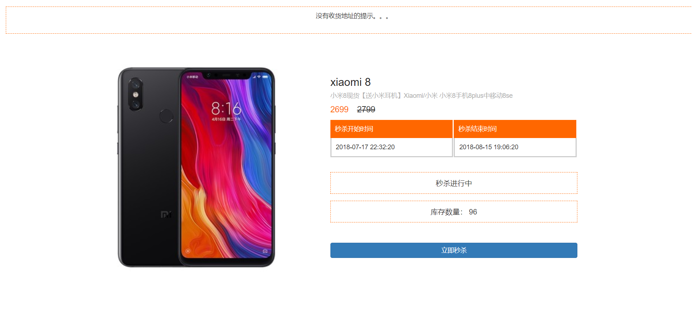
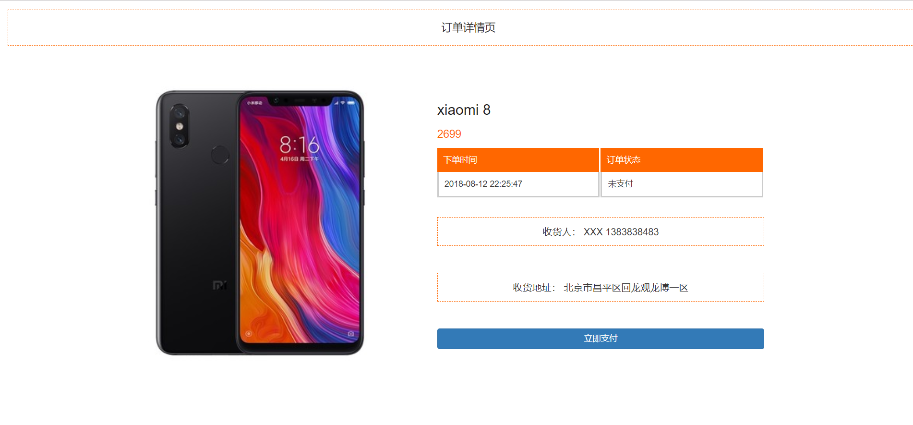

## 基于 SpringBoot+Mybatis+Redis+RabbitMQ 秒杀系统

## 友情项目
📣📣📣 Libra-Platform微服务平台。基于SpringCloud & SpringCloudAlibaba & SpringBoot & Vue3开发，基于多租户SaaS模式的设计，拥有强大的用户中心（一个账号对应多业务身份），权限基于RBAC设计，支持蓝绿灰度发布、网关动态路由、服务治理（流量控制、熔断降级、系统自适应保护、服务鉴权）等功能。

地址： https://github.com/hfbin/LibraPlatform

## 项目启动说明

### 方式一：Docker Compose 一键起中间件（推荐）

```bash
# 1. 复制环境变量样例（可选，不复制则使用 compose 内置的开发默认值）
cp .env.example .env

# 2. 启动 MySQL / Redis / RabbitMQ（MySQL 首次启动会自动导入 ./sql 建表与初始数据）
docker compose up -d

# 3. 查看状态，等待 healthcheck 变为 healthy
docker compose ps
```

启动后：
- MySQL：`localhost:3307`（宿主机端口，避免与本机已安装的 MySQL 3306 冲突），库名 `seckill`，账号 `root` / 密码 `123456`
- Redis：`localhost:6380`（宿主机端口，避免与本机其它项目占用的 6379 冲突），密码 `123456`
- RabbitMQ：`localhost:5672`，管理控制台 http://localhost:15672 （`admin` / `admin123`）
- 秒杀队列 `seckill.queue` 由 Spring AMQP 在应用启动时自动声明，无需手动创建。

> 注意：Spring Boot 不会自动读取 `.env` 文件。运行应用前，请把上面的连接信息设置为系统环境变量或在 IDE 运行配置中填入（`MYSQL_PASSWORD`、`REDIS_PASSWORD`、`RABBITMQ_USERNAME`、`RABBITMQ_PASSWORD` 等），密码已不再硬编码在 `application.properties` 中。

### 方式二：使用已有的中间件

自行准备 redis、mysql、rabbitmq，并通过环境变量注入连接信息与密码（参考 `.env.example`）。

### 访问地址

- 登录地址：http://localhost:8888/page/login
- 商品秒杀列表地址：http://localhost:8888/goods/list

## 其它说明

1、数据库共有一千个用户左右（手机号：从18077200000~18077200998 密码为：123456），为压测准备的。（使用 cn.hfbin.seckill.util.UserUtil.java该类生成的，生成token做压测也是在此类里面）

2、此项目共有两个分支，master分支只是完成了秒杀的所有业务逻辑功能，并没有优化。V2.0分支做了优化如下：

    1)、页面缓存、商品详情静态化、订单静态化（感兴趣可以把所有页面都做静态化）
    2)、加入消息队列RabbitMQ，对秒杀接口进行优化。
    3)、隐藏秒杀接口地址
    4)、接口限流防刷
    5)、解决超卖问题

### 页面截图
登录页

商品列表情页

商品详情页

订单详情页


